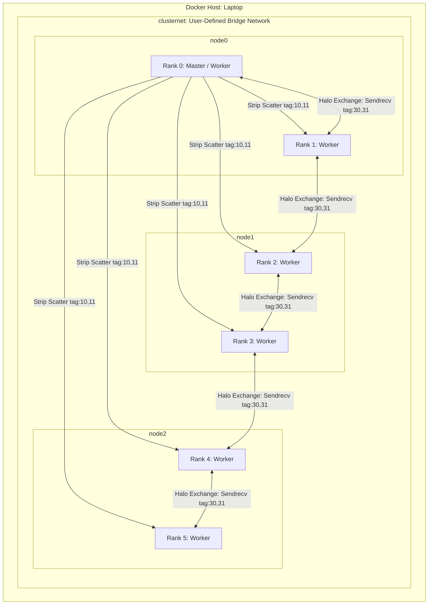

# Parallel Image Filtering with MPI: Halo Exchange and Deadlock Analysis

> A reproducible 3-node containerized cluster running distributed 3x3 image convolution with Open MPI, eliminating boundary artifacts via halo exchange (`Sendrecv`), and analyzing a silent concurrency deadlock under scaling.

**Author:** Moaaz Sherif · **Course:** SCx61 Distributed Computing · **Week 2 — MPI Point-to-Point**

---

## 1. The Problem

In scientific computing and image processing, applying a spatial stencil operation like a $3 \times 3$ box blur to an image requires neighboring pixel data for every target pixel. When dividing a large grayscale image (e.g. $512 \times 300$) into horizontal row strips distributed across 6 MPI processes, each process computes only on its assigned slice.

Without communication between adjacent ranks (the naive decomposition in `v1`), each worker replicates its own edge rows. This creates artificial discontinuous boundaries (visible seams) at row indices `49-50, 99-100, 149-150, 199-200, 249-250`. To prove correctness mathematically, we evaluate the distributed output against a canonical single-process reference (`filter_ref.py`), ensuring $0$ differing pixels rather than relying on subjective visual inspection.

---

## 2. Architecture



- **Placement:** A 3-node Docker Compose cluster (`node0`, `node1`, `node2`) running Debian Bookworm with Open MPI 4.1.4 and passwordless SSH. The `hostfile` specifies 2 slots per node, mapping 6 total ranks.
- **Master Responsibilities:** Rank 0 loads the image, partitions it evenly across strips, scatters metadata/pixels via point-to-point communication, collects processed tiles, and verifies against the serial oracle.
- **Halo Communication:** Point-to-point halo exchange occurs directly between adjacent ranks ($i \leftrightarrow i-1$ and $i \leftrightarrow i+1$), without passing through Rank 0.

---

## 3. How to Run It

Tested on **Windows 11 / Docker Desktop (WSL2 Engine) / Open MPI 4.1.4 / Python 3.11**.

```bash
# 1. Start the 3-node cluster
cd config
docker compose up -d --build
docker compose ps

# 2. Enter node0 as user 'student' in the mounted workspace
docker compose exec -u student -w /home/student/work node0 bash

# 3. Inside node0: Generate test image and canonical serial oracle
python3 make_test_image.py --width 512 --height 300 --out-prefix test_image
python3 -c "import numpy as np; from filter_ref import box_blur_3x3; np.save('test_image_filtered_serial.npy', box_blur_3x3(np.load('test_image.npy')))"

# 4. Run naive parallel filter (v1: no halo) and compare
mpirun --hostfile hostfile -n 6 python3 img_mpi_v1_nohalo.py
python3 compare.py --candidate test_image_filtered_v1

# 5. Run correct parallel filter (v2: with halo exchange) and compare
mpirun --hostfile hostfile -n 6 python3 img_mpi_v2_halo.py
python3 compare.py --candidate test_image_filtered_v2
```

---

## 4. Results

| Implementation | Differing Pixels vs Serial Oracle | Differing Rows | Status |
|---|---|---|---|
| **v1: No Halo** | **5,120 / 153,600** (3.33%) | `49-50, 99-100, 149-150, 199-200, 249-250` | Fails (Seam artifacts) |
| **v2: Halo Exchange (`Sendrecv`)** | **0 / 153,600** (0.00%) | None | **Pass (Bit-identical)** |

---

## 5. The Deadlock Incident

During scale testing with wide images ($8192 \times 300$), a naive pairwise halo exchange implementation with separate blocking `comm.Send` and `comm.Recv` resulted in a **silent hang**:
- All containers remained `Up (healthy)`.
- No exception or error was raised; the program timed out after 20 seconds (`exit code 124`).
- **Root Cause:** Open MPI switches from the eager protocol to synchronous rendezvous mode when message size exceeds internal eager buffering limits. All ranks attempted to send to their neighbors before posting receives, causing a cyclic dependency deadlock.
- **Resolution:** Replaced independent blocking `Send`/`Recv` calls with atomic `comm.Sendrecv`, which posts both buffers concurrently and eliminates cyclic dependencies.

See the complete investigation and diagnostic evidence in [INCIDENT.md](INCIDENT.md).

---

## 6. AI-Assisted Engineering

Documented in [AI_LOG.md](AI_LOG.md).
- **Assistance:** AI effectively structured the deadlock hypothesis around eager vs. rendezvous threshold behavior and suggested an `Ssend` diagnostic.
- **Verification Rule:** Claims suggesting simple eager-buffer expansion (`--mca btl_vader_eager_limit 16384`) were experimentally **refuted / proven to hide the symptom**, as the deadlock reoccurred once the image width reached 20,000 pixels. True architectural safety requires `Sendrecv`.

---

## 7. Next Steps
- Implement non-blocking halo exchange (`MPI_Isend` / `MPI_Irecv` with `MPI_Waitall`) to overlap stencil computation with halo communication.
- Generalize domain decomposition to 2D Cartesian grids (`MPI_Cart_create`) for higher scalability across core counts.

---

## Credits
Course materials and lab framework from **SCx61 Distributed Computing**, instructed by **Eng. Norhan Saber**, Scientific Computing Department, Faculty of Computers and Artificial Intelligence, Benha University.
